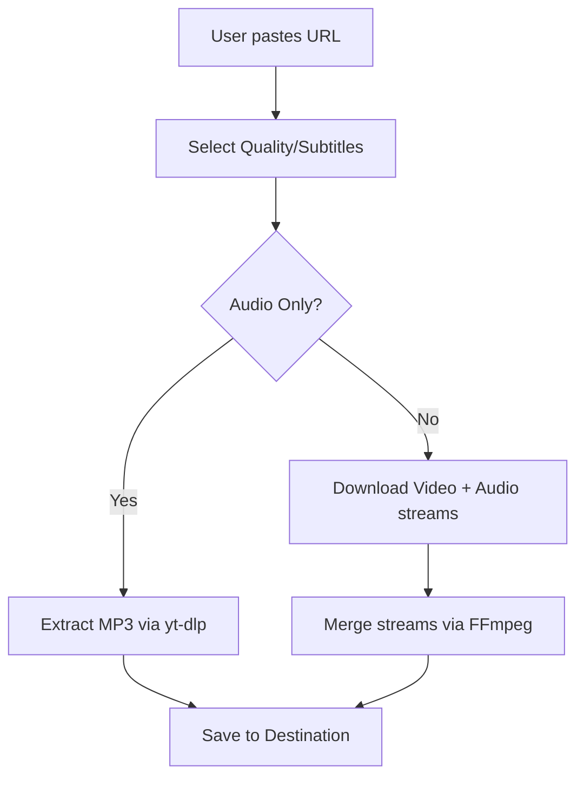

# Code Documentation

## 1. File & Folder Structure

```text
yt-downloader/
│
├── .git/                         # Git version control directory
├── LICENSE                        # GPL v3 License file
├── README.md                      # General project overview
├── CODE_DOCUMENTATION.md          # This file (Technical details)
├── DESIGN_PHILOSOPHY.md           # Design principles and rationale
├── CONTRIBUTING.md                # Guidelines for contributors
│
├── run_downloader.bat / .sh             # Master orchestrator script
├── youtube_download.bat / .sh           # Script for single video downloads
├── youtube_shorts_download.bat / .sh    # Script for YouTube Shorts
├── youtube_bulk_download.bat / .sh      # Script for playlists/channels
│
└── tests/                         # Unit tests for Batch and Bash scripts
```

## 2. High-Level Architecture

The project utilizes a hub-and-spoke architecture. `run_downloader.bat` serves as the central hub, executing the specialized scripts based on user requirements.

## 3. Core Modules & Functionality

| Script | Primary Role | Key Parameters Handled |
| :--- | :--- | :--- |
| `run_downloader` (.bat/.sh) | Master Menu | Option Selection (0-4), Safe pip update fallback |
| `youtube_download` (.bat/.sh) | Single Video | URL, Quality (1080p-360p/Best/Audio), Subtitles |
| `youtube_shorts_download` (.bat/.sh) | Shorts (Single/Bulk) | URL, Quality, Range Selection |
| `youtube_bulk_download` (.bat/.sh) | Playlists/Channels | URL, Quality, Subtitles, Range Selection |

## 4. Data Flow



## 5. Dependencies
 
### Runtime Dependencies
- **yt-dlp**: Required for fetching media streams.
- **ffmpeg**: Required for post-processing (merging audio/video, audio conversion). Strictly enforced for MP3 audio extraction, warning displayed for video merging.
 
### Developer Dependencies
- None (Vanilla batch and bash scripting).
 
## 6. Security and Robustness (Unix & Windows)
 
Both Unix and Windows scripts are hardened against common shell scripting vulnerabilities:
1. **Safe Input Parsing**: Interactive prompts use `read -rp` (Bash) and `setlocal enabledelayedexpansion` with `!VAR!` expansion (Batch) to safely read user choices without parsing command characters or breaking on parenthesized sections.
2. **Safe Array Expansion**: Argument flags (like `--playlist-items` or `--write-subs`) are dynamically generated as Bash Arrays `("${ARRAY[@]}")` on Linux. On Windows, command structures are built using strict conditional logic (`if defined RANGEFLAGS`) to avoid empty variable expansions that crash CMD execution.
3. **Graceful Error Handling**: 
   - Directory creation (`mkdir -p` or `mkdir`) is verified dynamically.
   - Network connectivity checks use a non-blocking `curl` request with a timeout limit (`--connect-timeout 5`) and User-Agent spoofing (`-A "Mozilla/5.0"`).
   - In shell scripts, `set -euo pipefail` is used safely by wrapping `yt-dlp` calls inside `set +e` and `set -e` blocks to properly evaluate the process exit status without terminating the script prematurely.
4. **Shared Session Archive**: Utilizes a centralized duplicate tracking archive (`archive.txt` placed in the script's directory) to record downloaded IDs across multiple executions, regardless of changes to the target output folders.

## 7. Execution Flow
 
1. **Entry Point**: User launches `run_downloader.bat` or `run_downloader.sh`.
2. **Routing**: User selects a script, which is launched via `call` or `bash`.
3. **Initialization**: Checks for dependency installations (`yt-dlp`/`ffmpeg`) and performs an internet status check.
4. **Input Gathering**: Captures URL, quality choices, subtitles, and range parameters.
5. **Command Assembly**: Dynamically evaluates the required flags.
6. **Execution**: Calls `yt-dlp` with the validated flags.
7. **Loopback**: Returns control to the master menu upon completion.

## 8. Test Suite

The project includes an automated test suite located inside the `tests/` directory to validate script parameters, quality mapping, dependencies, and syntax:
*   **Windows Batch Tests**: Run `tests/run_all_tests.ps1` in PowerShell. It verifies correct conditional parameters, subtitles mapping (English, Tamil, All), quality mapping (4K, 2K, 1080p, etc.), command checks (`where`), script directories (`%~dp0`), and exit codes.
*   **Linux/Mac Shell Tests**: Run the corresponding shell test scripts under `tests/` to validate array expansion, Ctrl+C trap functions, and wrapper robustness.

