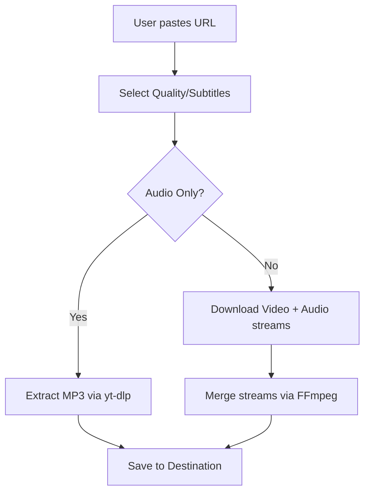

# Code Documentation

## 1. File & Folder Structure

```text
yt-downloader/
│
├── .git/                         # Git version control directory
├── .gitignore                     # Ignores local config (downloader.conf) and temp files
├── LICENSE                        # GPL v3 License file
├── README.md                      # General project overview
├── CODE_DOCUMENTATION.md          # This file (Technical details)
├── DESIGN_PHILOSOPHY.md           # Design principles and rationale
├── CONTRIBUTING.md                # Guidelines for contributors
├── ds.md                          # Change report (configuration & hardening pass)
├── SOCIAL_MEDIA.md                # Release announcement copy (LinkedIn / Reddit / X)
│
├── run_downloader.bat / .sh             # Master orchestrator script
├── youtube_download.bat / .sh           # Script for single video downloads
├── youtube_shorts_download.bat / .sh    # Script for YouTube Shorts
├── youtube_bulk_download.bat / .sh      # Script for playlists/channels
├── downloader.conf.example              # Template config (copy to downloader.conf to set SAVE_DIR)
│
└── tests/                         # Unit tests for Batch and Bash scripts
```

## 2. High-Level Architecture

The project utilizes a hub-and-spoke architecture. `run_downloader` (`.bat`/`.sh`) serves as the central hub, executing the specialized scripts based on user requirements.

## 3. Core Modules & Functionality

| Script | Primary Role | Key Parameters Handled |
| :--- | :--- | :--- |
| `run_downloader` (.bat/.sh) | Master Menu | Option Selection (0-4), Safe pip update fallback (tries each installer until one succeeds) |
| `youtube_download` (.bat/.sh) | Single Video | URL, Quality (1080p-360p/Best/Audio), Subtitles |
| `youtube_shorts_download` (.bat/.sh) | Shorts (Single/Bulk) | URL, Quality, Range Selection |
| `youtube_bulk_download` (.bat/.sh) | Playlists/Channels | URL, Quality, Subtitles, Range Selection |

All download scripts read the optional `downloader.conf` for the default `SAVE_DIR`, validate the pasted URL, validate any download range, auto-enable a JavaScript runtime when needed, and (in single-item modes) pass `--no-playlist`.

## 4. Data Flow



## 5. Dependencies
 
### Runtime Dependencies
- **yt-dlp**: Required for fetching media streams.
- **ffmpeg**: Required for post-processing (merging audio/video, MP3 conversion). All scripts report when it is missing, and MP3 extraction is refused when it is absent.
 
### Developer Dependencies
- None for the scripts themselves (vanilla batch and bash). Running the test suite requires PowerShell on Windows and Bash on macOS/Linux.
 
## 6. Security and Robustness (Unix & Windows)
 
Both Unix and Windows scripts are hardened against common shell scripting vulnerabilities:
1. **Safe Input Parsing**: Interactive prompts use `read -rp` (Bash) and `setlocal enabledelayedexpansion` with `!VAR!` expansion (Batch) to safely read user choices without parsing command characters or breaking on parenthesized sections. `downloader.conf` is parsed as plain text (never `source`d/evaluated), and the batch scripts read it *before* enabling delayed expansion so a `!` in a path is preserved.
2. **Safe Array Expansion**: Argument flags (like `--playlist-items` or `--write-subs`) are dynamically generated as Bash Arrays. Empty arrays are expanded with the portable guard `"${ARRAY[@]+"${ARRAY[@]}"}"`, which is safe under `set -u` on every Bash version, including the Bash 3.2 that ships with macOS. On Windows, flags are expanded with delayed expansion (`!RANGEFLAGS!`); an empty value simply collapses to a harmless extra space.
3. **Graceful Error Handling**: 
   - Directory creation (`mkdir -p` or `mkdir`) is verified dynamically, including a follow-up check that the folder really exists.
   - Both platforms check connectivity with a non-blocking `curl` request with a timeout limit (`--connect-timeout 5`) and User-Agent spoofing (`-A "Mozilla/5.0"`); a failure only prints a warning and never aborts the download.
   - In shell scripts, `set -euo pipefail` is used safely by wrapping `yt-dlp` calls inside `set +e` and `set -e` blocks to properly evaluate the process exit status without terminating the script prematurely. The "open folder" helpers are guarded with `|| true` so they cannot abort the script under `set -e`.
4. **Shared Session Archive**: Utilizes a centralized duplicate tracking archive (`archive.txt` placed in the script's directory) to record downloaded IDs across multiple executions, regardless of changes to the target output folders.
5. **Input Validation**: URLs must begin with `http://` or `https://`, and download ranges may contain only digits, commas, and hyphens. Rejecting bad input early means it can never be interpreted as extra `yt-dlp` arguments (e.g. command injection through a crafted range).

## 7. Execution Flow
 
1. **Entry Point**: User launches `run_downloader.bat` or `run_downloader.sh`.
2. **Routing**: User selects a script, which is launched via `call` or `bash`.
3. **Initialization**: Checks for dependency installations (`yt-dlp`/`ffmpeg`) and performs an internet status check.
4. **Input Gathering**: Captures URL, quality choices, subtitles, and range parameters.
5. **Command Assembly**: Dynamically evaluates the required flags.
6. **Execution**: Calls `yt-dlp` with the validated flags.
7. **Loopback**: Returns control to the master menu upon completion.

## 8. Test Suite

The project includes an automated test suite located inside the `tests/` directory to validate script parameters, quality mapping, dependencies, syntax, and runtime behaviour:
*   **Windows Batch Tests**: Run `tests/run_all_tests.ps1` (static checks) and `tests/test_batch_files.ps1` (static checks plus functional tests that actually execute the batch files with a mocked `yt-dlp`). They verify conditional parameters, subtitle mapping (English, Tamil, All), quality mapping (4K, 2K, 1080p, etc.), command checks (`where`), script directories (`%~dp0`), exit codes, config-driven `SAVE_DIR`, URL/range validation, and `--no-playlist`.
*   **Linux/Mac Shell Tests**: Run `tests/run_all_tests.sh`, which runs each `tests/test_*.sh` file. These cover array expansion, the Ctrl+C trap, wrapper robustness, and a functional test that executes a script against a mocked `yt-dlp` to confirm config-driven `SAVE_DIR` and `--no-playlist`.

## 9. Configuration

`downloader.conf` (created by copying `downloader.conf.example`) is an optional, git-ignored key/value file. Today it supports a single key:

| Key | Meaning | If unset |
| :--- | :--- | :--- |
| `SAVE_DIR` | Default folder for downloads | The script asks for a folder each run (default: `Downloads` / `Shorts`) |

Parsing rules: one `NAME=VALUE` per line, no spaces around `=`, and lines starting with `#` are comments.

