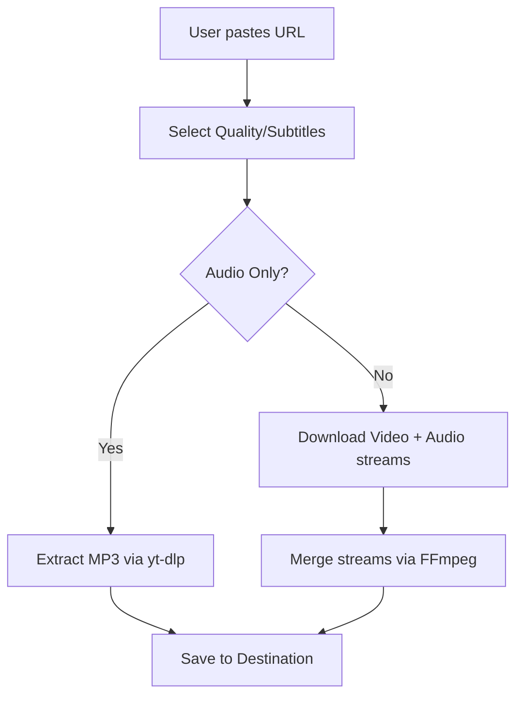

# Code Documentation

## 1. File & Folder Structure

```text
yt-downloader/
│
├── .git/                         # Git version control directory
├── LICENSE                        # GPL v3 License file
├── README.md                      # General project overview
├── CODE_DOCUMENTATION.md          # This file (Technical details)
├── DESIGN_PHILOSOPHY.md           # Design principles and rationale
├── CONTRIBUTING.md                # Guidelines for contributors
│
├── run_downloader.bat             # Master orchestrator script
├── youtube_download.bat           # Script for single video downloads
├── youtube_shorts_download.bat    # Script for YouTube Shorts
└── youtube_bulk_download.bat      # Script for playlists/channels
```

## 2. High-Level Architecture

The project utilizes a hub-and-spoke architecture. `run_downloader.bat` serves as the central hub, executing the specialized scripts based on user requirements.

## 3. Core Modules & Functionality

| Script | Primary Role | Key Parameters Handled |
| :--- | :--- | :--- |
| `run_downloader.bat` | Master Menu | Option Selection (0-3) |
| `youtube_download.bat` | Single Video | URL, Quality (1080p-360p/Best/Audio), Subtitles |
| `youtube_shorts_download.bat` | Shorts (Single/Bulk) | URL, Quality, Range Selection |
| `youtube_bulk_download.bat` | Playlists/Channels | URL, Quality, Subtitles, Range Selection |

## 4. Data Flow



## 5. Dependencies

### Runtime Dependencies
- **yt-dlp**: Required for fetching media streams.
- **ffmpeg**: Required for post-processing (merging audio/video, audio conversion).

### Developer Dependencies
- None (Vanilla batch scripting).

## 6. Execution Flow

1. **Entry Point**: User launches `run_downloader.bat`.
2. **Routing**: User selects a script, which is launched via `call`.
3. **Initialization**: The targeted script sets its specific environment.
4. **Input Gathering**: Captures URL, quality choices, and filter parameters.
5. **Command Assembly**: Dynamically builds the `yt-dlp` argument payload.
6. **Execution**: Calls `yt-dlp` with assembled flags.
7. **Loopback**: Returns control to the master menu upon completion.
