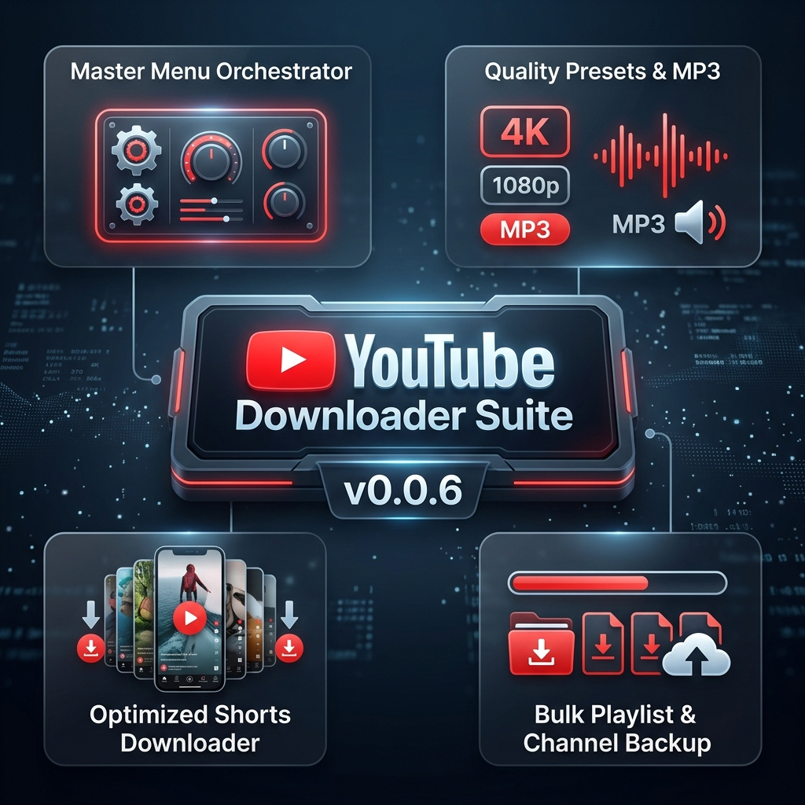
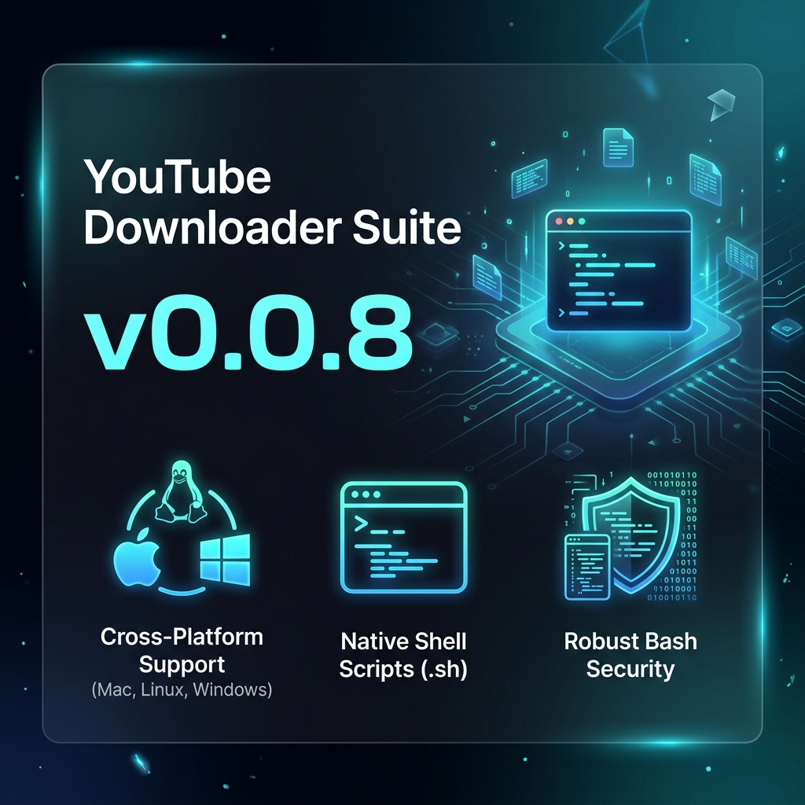
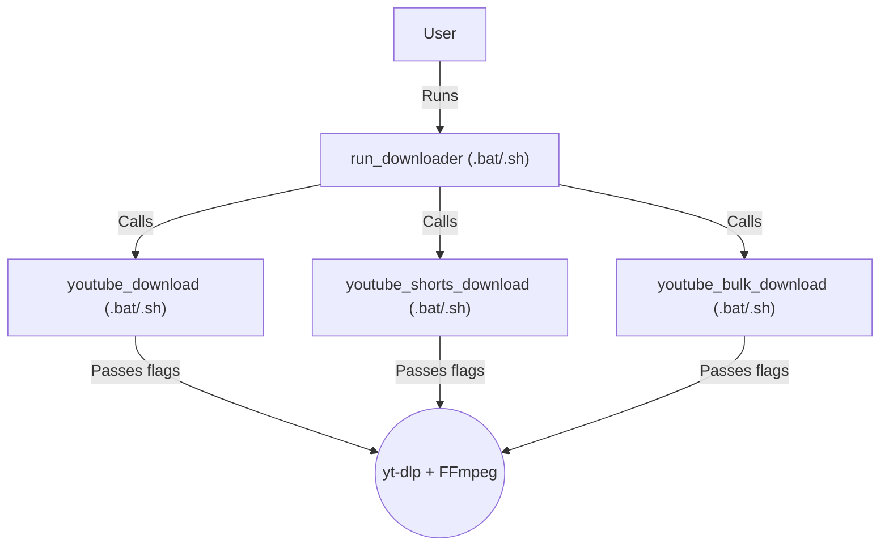

# YouTube Downloader Suite

  
  

A user-friendly collection of cross-platform scripts (.bat for Windows, .sh for Mac/Linux) for downloading YouTube videos, shorts, and playlists/channels with customizable quality and subtitle options.

## One-Liner
A collection of interactive command-line scripts to effortlessly download YouTube videos, shorts, and playlists using `yt-dlp` across all operating systems.

---

## Table of Contents
1. [Why and What is it Created For?](#why-and-what-is-it-created-for)
2. [Prerequisites](#prerequisites)
3. [How to Use It](#how-to-use-it)
4. [Code Functionality Documentation](#code-functionality-documentation)
5. [How the Files are Connected](#how-the-files-are-connected)

---

## Why and What is it Created For?

This project was created to remove the friction of using command-line tools for downloading media. While `yt-dlp` is an extremely powerful engine, its command-line arguments can be daunting for everyday use. 

**The Solution:** A set of simple, interactive wrapper scripts that prompt the user for basic inputs (URL, quality, subtitles) and handle the complex syntax automatically.

---

## Prerequisites

To use these scripts, you must have the following tools installed and added to your Windows **System PATH**:
1. **yt-dlp**: The core downloading engine. [Download yt-dlp](https://github.com/yt-dlp/yt-dlp)
2. **ffmpeg**: Required for merging high-quality video and audio streams. [Download FFmpeg](https://ffmpeg.org/)
3. **JavaScript Runtime**: Required by `yt-dlp` for modern YouTube extraction.
   - **Recommended**: [Deno](https://deno.com/) (or run `winget install --id=DenoLand.Deno` in terminal).
   - Alternative: [Node.js](https://nodejs.org/).

---

## How to Use It

1. **Clone/Download** this repository to your local machine.
2. **(Optional) Set Default Save Path**:
   - Open any `.bat` file in a text editor.
   - Locate the line: `set "SAVE_DIR=D:\5 System 6\Vidoes"`
   - Change it to your desired download directory (e.g., `set "SAVE_DIR=C:\Users\YourName\Downloads"`).
3. **Execute**: 
   - **Recommended**: Double-click `run_downloader.bat` to open the Master Menu and choose an option.
   - Alternatively, double-click the specific script directly:
     - `youtube_download.bat` for single videos.
     - `youtube_shorts_download.bat` for shorts.
     - `youtube_bulk_download.bat` for playlists/channels.
4. **Unix Execution (Mac/Linux)**: 
   - Open your terminal and give execution permissions: `chmod +x *.sh`
   - Run the master orchestrator: `./run_downloader.sh`
   - Or run specific scripts: `./youtube_download.sh`, etc.
5. **Follow Prompts**: Paste the URL and make your selections via the keyboard.

---

## Code Functionality Documentation

### 1. `run_downloader.bat` / `run_downloader.sh`
- **Purpose**: Master orchestrator providing a central menu.
- **Features**: Quick routing to specific scripts without opening multiple windows. Handles `yt-dlp` updates with robust permission fallback on Unix.

### 2. `youtube_download.bat` / `youtube_download.sh`
- **Purpose**: Downloads standalone YouTube videos.
- **Features**:
  - Quality presets: Best, 1080p, 720p, 480p, 360p, or Audio Only (MP3).
  - Subtitle downloading (supports English, Tamil, or all available).

### 3. `youtube_shorts_download.bat` / `youtube_shorts_download.sh`
- **Purpose**: Specifically handles YouTube Shorts.
- **Features**:
  - Supports individual short URLs OR channel shorts tabs.
  - Quality mapping adapted for standard mobile resolutions.
  - Range selection for bulk downloading channel shorts safely using bash arrays.

### 4. `youtube_bulk_download.bat` / `youtube_bulk_download.sh`
- **Purpose**: Automates mass downloads of playlists or entire channel uploads.
- **Features**:
  - Safely handles multi-video downloads sequentially.
  - Creates organized folders based on playlist titles.
  - Supports index ranges (e.g., downloading items 1 through 10).

---

## How the Files are Connected

The master orchestrator script centralizes operations, routing execution based on user choices.

While they operate independently, they share a unified configuration style, ensuring a seamless user experience regardless of the script chosen.
